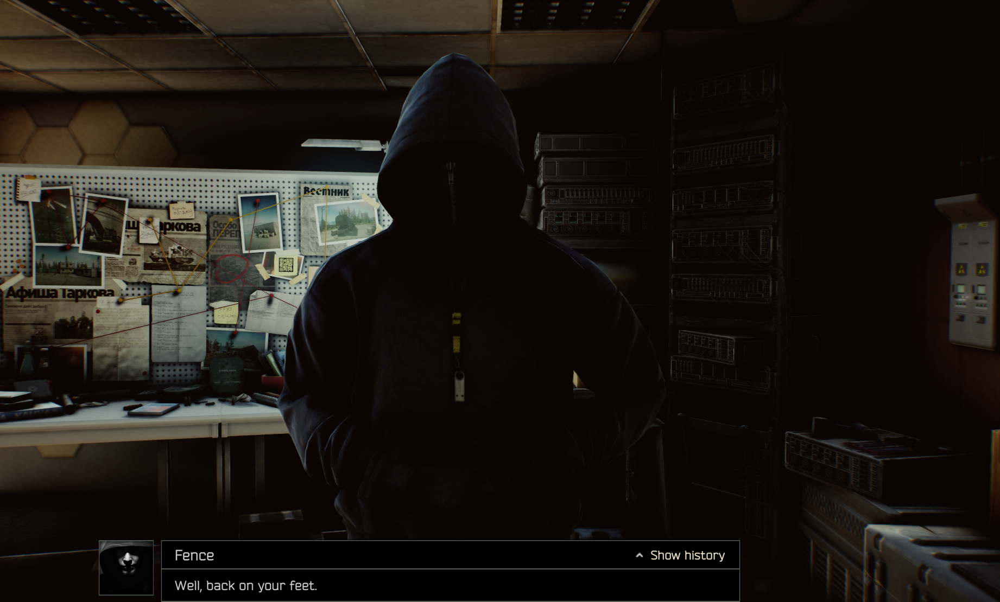

# OnlyFenceStoryLine

A mod for **SPT 4.1.6**. **VisitAPI 1.3.7 is required** (client and server).

**Alpha 0.1.2 · English, Russian and Korean localization**

**A new SPT profile is required for this alpha. Do not use an existing profile.**



## Requirements

- **SPT 4.1.6**, using **EFT 0.16.9.5.40743**.
- **[VisitAPI 1.3.7](https://github.com/TricolourSky/VisitAPI/releases)**: install both its client and server components first.
- **[OnlyFence](https://github.com/Klidevich/OnlyFence) is optional but recommended.** It is not required to install or run OnlyFenceStoryLine.

The release includes the room resources used by this mod. Installing the entire Storyline Backport content pack is not required. WTT CommonLib and FixPluginTypesSerialization are not used.

## Installation

1. Close the game and SPT server. Back up your profile and any existing files this mod replaces.
2. Install the required VisitAPI client and server components.
3. Download `OnlyFenceStoryLine-0.1.2-SPT-4.1.6.zip` from [Releases](https://github.com/Klidevich/OnlyFenceStoryLine/releases).
4. Extract the archive into your SPT installation folder, alongside `EscapeFromTarkov.exe`.
5. Start the SPT server. Create and select a **new profile** in the SPT Launcher, then start the game and create your character.

The main installed paths are:

```text
BepInEx/plugins/CustomQuests-E17/CustomQuests.E17.dll
BepInEx/config/VisitAPI/579dc571d53a0658a154fbec.dlg
BepInEx/plugins/VisitAPI/rooms/579dc571d53a0658a154fbec_fence
BepInEx/plugins/VisitAPI/rooms/vendors_scripts
SPT_Runtime/user/mods/CustomQuests-E17/CustomQuests.E17.Server.dll
SPT_Runtime/user/mods/VisitAPI-Server/packs/CustomQuests-E17/
```

If your VisitAPI server folder has a different name, put `packs/CustomQuests-E17` inside its actual `packs` directory. Do not create a second VisitAPI installation or a nested `rooms/rooms` folder. The internal folder names above are retained for compatibility.

This mod supplies Fence's dialogue file. Back up that file if another mod changes it; automatic merging is not supported. Shared room resources may also be used by other VisitAPI content.

Install the complete package, including **both DLLs and all content files**. Do not leave duplicate copies of either DLL in another plugin/mod folder. A new profile is mandatory for alpha testing, including when you have tried an earlier development build.

## Alpha status and feedback

This is an alpha release. In-game testing is in progress.

Please report the release version, game language, confirmation that you created a new profile, the steps taken, and the expected and actual results. Include relevant excerpts from `BepInEx/LogOutput.log` and the server log. Do not post full profiles or public story spoilers; contact the maintainer before sharing narrative details or screenshots containing them.

## Build the source

Install the **.NET 10 SDK**, then build against your own SPT installation with VisitAPI already installed:

```powershell
dotnet build Client/E17.Client.csproj -c Release -p:GamePath="C:\Path\To\SPT"
dotnet build Server/E17.Server.csproj -c Release -p:SptRuntime="C:\Path\To\SPT\SPT_Runtime"
```

Client output: `Client/bin/Release/net472/CustomQuests.E17.dll`.
Server output: `Server/bin/Release/net10.0/CustomQuests.E17.Server.dll`.

Building produces the two DLLs only. Use the matching release archive for the content files; narrative data and game assemblies are not included in this source repository. The projects do not deploy files into the game automatically.

## Credits

- **Klide** — creator, developer and maintainer.
- **ChatGPT / Codex (OpenAI)** — AI-assisted development, debugging, review and documentation.
- **TricolourSky** — VisitAPI and the Storyline Backport resources used by this release.
- **Battlestate Games** — original Escape from Tarkov assets.

See [Third-party notices](THIRD-PARTY-NOTICES.md). Not affiliated with Battlestate Games or the SPT team.
